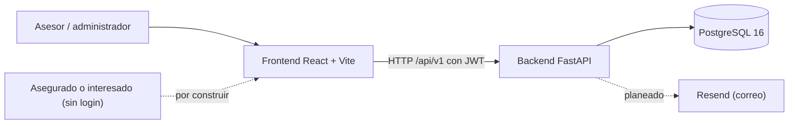

# Arquitectura
Última revisión: 2026-10-27

Fuente: inventario de archivos y búsquedas de solo lectura del 2026-10-27. No se leyó el contenido de modelos, servicios ni componentes. Lo no visto queda como [PENDIENTE].

## 1. Contexto
- **Asesores y administradores** de Juanfer Seguros usan el panel web (frontend React) con login.
- **Asegurados o interesados** abrirán un formulario por URL, sin login. Aún no existe (hito 3 de "Ahora").
- **Sistemas externos:** hoy ninguno. Planeado: Resend para correo (RF-014, "Siguiente").

## 2. Vista general

## 3. Módulos
| Módulo | Responsabilidad | Depende de | NO debe depender de | Doc propio |
|---|---|---|---|---|
| Autenticación | Login con JWT y control de acceso (`require_admin`, `require_auth`, `validate_id_asesor`). | core/security, usuarios | [PENDIENTE] | — |
| Prospectos | Pipeline de prospectos, conversión a cliente, importación CSV. | catálogos, clientes | [PENDIENTE] | — |
| Clientes | Búsqueda y registro de clientes. | [PENDIENTE] | [PENDIENTE] | — |
| Pólizas (producción) | Pólizas, importación y exportación, traspaso entre responsables e historial. | catálogos, clientes, historial | [PENDIENTE] | — |
| Dashboard | Métricas, alertas, producción mensual y distribución de estados. | pólizas | [PENDIENTE] | — |
| Catálogos | Lectura de catálogos y alta, edición y baja (solo admin) de algunos. | — | [PENDIENTE] | — |
| Formularios | Definición, versionado y respuestas de formularios. Solo hay modelos y migración. | catálogos (por diseño) | [PENDIENTE] | docs/modulos/formularios.md (se crea al abrir el hito 1) |

### Cobertura por capa (hecho, según el inventario)
| Módulo | Router (endpoints) | Schema | Service (líneas) | Modelos | Front |
|---|---|---|---|---|---|
| Autenticación | `auth` (1) | sí | sí (30) | `usuario`, `roles_permisos` | `Login`, `AuthContext`, `ProtectedRoute` |
| Usuarios | `usuario` (1) | sí | sí (43) | `usuario` | — |
| Prospectos | `prospecto` (10) | sí | sí (547) | `prospecto`, `nota_prospecto` | `pages/prospectos`, `api/prospectos.js` |
| Clientes | `cliente` (3) | sí | sí (188) | `cliente` | sin página propia visible |
| Pólizas | `poliza` (11) | sí | sí (953) | `poliza`, `historial_responsable*` | `pages/produccion`, `api/polizas.js`, `api/importExport.js` |
| Dashboard | `dashboard` (4) | sí | no tiene service propio | `config_alerta` | `pages/dashboard`, `api/dashboard.js` |
| Catálogos | `catalogo` (21: 6 GET, 5 POST, 5 PUT, 5 DELETE) | sí | sí (315) | `catalogos/*` | `api/catalogos.js`, `pages/admin/AdminCatalogos.jsx` (ruta `/admin/catalogos`, solo ADMIN; contenido sin leer) |
| Formularios | no existe | no existe | no existe | 5 modelos + `constantes.py` | no existe |

**Modelos sin router ni pantalla:** `cotizacion`, `tarea`, `cancelacion`, `cambio_intermediario`, `endoso_banco`, `conversacion`, `mensaje`, `plantilla_mensaje`, `link_proceso`, `auditoria`. En el front, las rutas de cotizaciones, cancelaciones y plantillas están comentadas.

**Catálogos sin endpoints:** solo se exponen estados de prospecto (GET), estados de póliza, aseguradoras, productos, ramos y tipos de documento. No hay endpoints para `banco`, `estado_cotizacion`, `estado_tramite_banco`, `estado_cambio_intermediario`, `nivel_alerta`, `categoria_mensaje` ni para `catalogo_tipo` / `catalogo_valor`. Los estados de prospecto solo se leen. Qué catálogos debe editar el panel sigue abierto (REQUISITOS, RF-012).

## 4. Flujo de datos crítico
**Hoy (autenticación y consulta):**
1. El front llama `POST /api/v1/auth/login` (esquema OAuth2 de contraseña).
2. El backend emite un JWT firmado con `SECRET_KEY`.
3. Cada petición posterior lleva el token; `get_current_user_data` lo valida y `require_admin` restringe las rutas de administrador.
4. Router → service → modelo SQLAlchemy síncrono → PostgreSQL.

Dónde guarda el front el token, y si el JWT expira: [PENDIENTE].

**Por diseñar (envío de formulario público):** aún no existe. Debe seguir RF-009, RF-010, RNF-002, RNF-003 y RNF-010: abrir por token no enumerable, enviar contra una versión fija del formulario, guardar la respuesta y solo después notificar por correo. Se detalla al cerrar el hito 1.

## 5. Modelo de datos
- **Organización:** `app/models/` agrupa por dominio: `auditoria`, `catalogos`, `dashboard_alertas`, `formularios`, `historial`, `modulos_negocio`, `operaciones`, `plantillas_conocimiento`, `roles_permisos`, `usuarios_clientes`. `app/db/base.py` (4 líneas) parece la `Base` declarativa (inferencia).
- **Catálogos con dos estilos a la vez:** tablas específicas (`aseguradora`, `banco`, `ramo`, `producto`, `estado_*`, `tipo_documento`, `nivel_alerta`, `categoria_mensaje`) y un par genérico (`catalogo_tipo` + `catalogo_valor`). Cuál usarán los formularios y el panel: [PENDIENTE].
- **Formularios (ya modelados, sin leer):** `formulario`, `formulario_version`, `formulario_grupo_pregunta`, `formulario_pregunta` y `formulario_respuesta`, más `constantes.py`. La jerarquía recuerda a la opción normalizada de la decisión pendiente D-D; falta leerlos y compararlos con los 17 formularios reales.
- **Nombres de tablas:** [PENDIENTE]. La búsqueda de `__tablename__` no recorrió las subcarpetas.
- **Migraciones (Alembic, cadena lineal confirmada con `alembic history`, de la más antigua a la más reciente):** `1862ff089733_init_juanferdb_v1`, `871cc6d526bd_m3_prospectos_pipeline`, `07f706ae928e_m3_fix_en_prospecto_producto_id_`, `0122a2ce8ea1_m3_feat_agregar_updated_at_en_prospecto`, `98500168c7d6_v3_agregar_tablas_para_formularios`. Head: `98500168c7d6`. Reglas en D-004 y D-008.
- **Enums:** `app/enums.py` solo define `BulkUpsertMode`.

## 6. Seguridad
- **Autenticación:** OAuth2PasswordBearer + JWT con `python-jose`; hash de contraseñas con `passlib` y `bcrypt` (están en las dependencias; el uso no se leyó).
- **Autorización:** `require_admin` en altas, ediciones y bajas de catálogos; el resto exige token (`get_current_user_data`). Front: `ProtectedRoute` con `rolRequerido="ADMIN"` para `/admin/catalogos`. Falta revisar el uso en los demás routers: la búsqueda se cortó en 25 líneas, todas de `catalogo.py`.
- **Secretos:** `DATABASE_URL` y `SECRET_KEY` en `backend/.env`; ningún `.env` está rastreado en git.
- **CORS:** `allow_origins=["*"]` en `main.py`. Ver DT-011.
- **Datos sensibles:** datos personales de prospectos y clientes. Los formularios públicos sumarán Ley 1581 de 2012 (RNF-005).
- **Validación de entrada:** esquemas Pydantic en `app/schemas/`. Los endpoints públicos de formularios no existen todavía.
- **Rutas públicas hoy:** `/health` y `/api/v1/auth/login`.

## 7. Despliegue
[PENDIENTE], diferido a propósito (D-005). El repo trae `docker-compose.yml` con `db`, `backend`, `frontend` y `nginx`, y se prevé desplegar con Dokploy (aún no conectado al repo; no se ha hecho ningún despliegue). Los hallazgos están en DEUDA (DT-001 a DT-005 y DT-010).

## 8. Convenciones
- **Backend:** `app/{core,db,models,routers,schemas,services,utils}`. Todas las rutas bajo `/api/v1`. Los endpoints son `def` síncronos con `Session = Depends(get_db)`. Hay un solo `async def` en los routers (ver DT-009). Un archivo de servicio ya llega a 953 líneas (`services/poliza.py`).
- **Capas (inferida del inventario, sin verificar imports):** router → service → modelo. Se confirma o se corrige al leer el código.
- **Frontend:** `api/`, `components/`, `context/`, `pages/<modulo>/` (un `.jsx` y un `.css` por pantalla), `router/`, `styles/`. Patrón mock-first: con `VITE_USE_MOCK=true` usa datos locales (`mocks/`) en lugar del backend. `BASE_URL` sale de `VITE_API_URL` y, si falta, vale `http://localhost:8000`.
- **Reglas del front** (tokens, 1000 líneas, responsive, claro y oscuro): ver `CLAUDE.md`.
- **Manejo de errores y logging:** [PENDIENTE].

## 9. Riesgos conocidos
Ver docs/DEUDA.md (DT-001 a DT-012).

## 10. Decisiones relacionadas
D-001 a D-008 (docs/DECISIONES.md). Pendiente de decisión: el modelo de datos de formularios (D-D).
